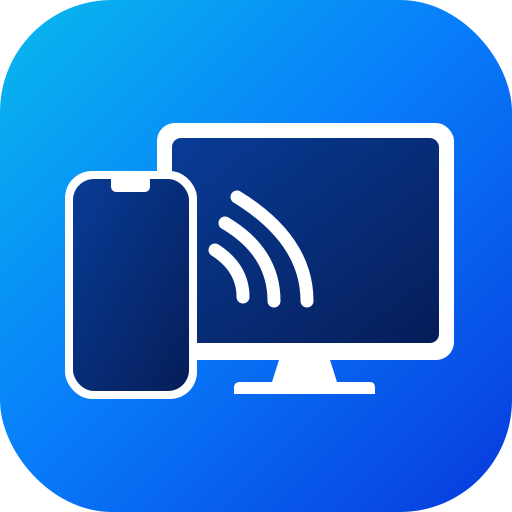

# Contributing to OpenMirrorPhone

Thank you for wanting to help! OpenMirrorPhone is a free, open-source project, and every
bug report, idea, fix and improvement makes it better for everyone.

## Ways to help

- **Report a bug.** Open an [issue](https://github.com/ImElio/openmirrorphone/issues) with
  your Windows version, the device and iOS/iPadOS/macOS version you mirror from, what you did
  and what happened. A log helps a lot: build the console version (see
  [Building](#building)) and run it with `-d`.
- **Suggest a feature.** Open an issue describing what you'd like to do and why.
- **Improve the documentation.** Typos, unclear steps and missing troubleshooting tips are
  all welcome.
- **Send code.** See below.

Security problems are the exception: please don't open a public issue, follow
[SECURITY.md](SECURITY.md) instead.

## Pull requests

1. Fork the repository and create a branch for your change.
2. Keep the change focused: one fix or feature per pull request.
3. Build it with no warnings (`-Wall -Wextra` are on) and test it with a real device,
   following the [checklist](#testing-checklist).
4. In the pull request, say what changed, why, and how you tested it (device, iOS version).

### Code style

- C++17, 4-space indentation, lines up to about 120 characters.
- Match the code around your change: naming, comments, error handling.
- Comments explain *why*, not *what*.
- Text shown to users is in English.
- Don't edit `third_party/airplay/` except when updating it from UxPlay (see
  [Updating the AirPlay core](#updating-the-airplay-core)). Fixes that belong in the AirPlay
  core are best sent to [UxPlay](https://github.com/FDH2/UxPlay) as well.
- Don't use Apple trademarks (the AirPlay icon, the Apple logo) in the UI or the logo.

### Testing checklist

There are no automated tests yet: changes are tested by hand with a real iPhone or iPad.

- [ ] The PC appears in Screen Mirroring and mirroring starts
- [ ] Sound plays, and the volume buttons on the device change it
- [ ] Full screen with double-click and F11; Esc leaves it
- [ ] R starts and stops a recording; the MP4 opens in VLC with picture and sound in sync
- [ ] Settings: renaming the receiver shows the new name on the device
- [ ] Settings: a session can be renamed (its MP4 too) and deleted
- [ ] Stopping mirroring on the device returns to the waiting screen
- [ ] If you touched the updater: an update from a local feed installs and shows What's New
      (see [Publishing a release](#what-the-auto-updater-expects))

### Licence

OpenMirrorPhone is licensed under the [GPLv3](LICENSE). By contributing, you agree that your
contribution is released under the same licence.

## Building

### Environment

You need [MSYS2](https://www.msys2.org/) installed in `C:\msys64`. From the MSYS2 **UCRT64** shell:

```bash
pacman -Syu
pacman -S --needed mingw-w64-ucrt-x86_64-{gcc,cmake,ninja,pkgconf,openssl,libplist,ffmpeg,SDL2,SDL2_ttf,nsis}
```

`nsis` is only needed to build the installer with `package.sh`.

For debugging you also need `mingw-w64-ucrt-x86_64-gdb`; to regenerate the icons from the SVG
logo, `rsvg-convert` (part of `mingw-w64-ucrt-x86_64-librsvg`, already installed with FFmpeg).

### Development build

```bash
./build.sh
```

Builds `build/openmirrorphone.exe` **with a console**, so the log is visible. The scripts run
from Git Bash or any bash and call the UCRT64 toolchain themselves.

To run it outside MSYS2, the DLLs must be on the PATH:

```bash
PATH="/c/msys64/ucrt64/bin:$PATH" ./build/openmirrorphone.exe -d
```

Debug build, to run under gdb:

```bash
MSYSTEM=UCRT64 /c/msys64/usr/bin/bash -lc "cmake -S . -B build-dbg -G Ninja -DCMAKE_BUILD_TYPE=Debug && cmake --build build-dbg"
PATH="/c/msys64/ucrt64/bin:$PATH" gdb -ex run --args build-dbg/openmirrorphone.exe -d
```

### Distributable package

```bash
./package.sh
```

It makes three things, all named after the version in `project(... VERSION x.y.z)`:

- `dist/`: `OpenMirrorPhone.exe` **without a console** (`-DOPENMIRRORPHONE_GUI=ON`), every DLL
  it needs and `LICENSE.txt`. The DLLs are found by following the import tables of the exe
  and of each DLL, copying everything MSYS2 provides. It never relies on where Windows would
  load a DLL from on the build PC: a copy that happens to sit in `System32` there would be
  missing on every other PC. The script then checks that nothing is missing and stops if it is.
- `release/OpenMirrorPhone-<version>-win64.zip`: `dist/` zipped, files at the root. This is the
  portable version and what the auto-updater downloads.
- `release/OpenMirrorPhone-<version>-setup.exe`: the installer, made with NSIS from
  `installer/OpenMirrorPhone.nsi`. It installs per user in `%LOCALAPPDATA%\Programs` (no
  administrator rights, and a folder the updater can write to), adds a Start menu shortcut,
  registers the uninstaller in Windows' installed apps and offers Apple's Bonjour download
  page if Bonjour is missing. Its side image comes from `installer/welcome.svg`.

See [Publishing a release](#publishing-a-release) for what to upload.

### Updating the AirPlay core

The core is a copy of UxPlay's `lib/` ([UxPlay](https://github.com/FDH2/UxPlay)); the commit
it comes from is in `third_party/airplay/VERSION`. To update it:

1. Clone UxPlay and copy its `lib/` over `third_party/airplay/`, leaving out `mdnsd/`.
2. Update `VERSION` with the new commit, and `LICENSE.UxPlay`.
3. Rebuild and check `src/receiver.cpp`: if `raop_callbacks_t` in `raop.h` has new
   callbacks, add them.

The `CMakeLists.txt` files inside `third_party/airplay` are not used: the libraries are
defined in the top-level `CMakeLists.txt`.

### Regenerating the icons from the logo

The brand kit already provides every size (see [Brand kit](#brand-kit)). If only
`assets/logo.svg` changes, regenerate the PNGs:

```bash
cd assets
for s in 16 24 32 48 64 128 256 512 1024; do rsvg-convert -w $s -h $s logo.svg -o icons/icon_$s.png; done
cp icons/icon_512.png logo.png
```

Then build `logo.ico` from the 16, 24, 32, 48, 64, 128 and 256 px versions (for example with
ImageMagick: `magick icons/icon_16.png icons/icon_24.png ... icons/icon_256.png logo.ico`) and
rebuild: `src/app.rc` embeds `logo.ico` in the exe.

## How the code is organised

| Path | Contents |
|---|---|
| `src/main.cpp` | SDL2 window, waiting screen, menu bar, full screen, keys, main loop |
| `src/receiver.cpp` | Starts Bonjour and the AirPlay server; receives the core's callbacks and forwards them |
| `src/video_decoder.cpp` | H.264/H.265 decoding with FFmpeg; keeps only the newest frame |
| `src/audio_player.cpp` | ALAC/AAC decoding with FFmpeg, conversion to 16-bit PCM, SDL audio queue |
| `src/recorder.cpp` | MP4 recording: H.264 remuxed as is, audio re-encoded to AAC-LC |
| `src/sessions.cpp` | Session history in `%APPDATA%\OpenMirrorPhone\sessions.tsv`; renames recordings |
| `src/settings.cpp` | Receiver name saved in `%APPDATA%\OpenMirrorPhone\settings.ini` |
| `src/settings_dialog.cpp` | Native Settings dialog (name, session list, updates) and About box |
| `src/updater.cpp` | Reads GitHub Releases, downloads the zip, swaps the app's files, restarts |
| `src/update_dialog.cpp` | "Update available" (with download progress) and "What's New" dialogs |
| `src/welcome_dialog.cpp` | First-launch Welcome window with the PayPal donate button (also Help → Support) |
| `src/network.cpp` | MAC address (receiver ID), PC name, data and video folders, UTF-8/UTF-16 helpers |
| `src/app.rc`, `src/resource.h` | Icon, manifest, menu bar, Settings dialog layout, version info |
| `src/app.manifest` | Enables Common Controls 6, so the dialog has the native Windows 10/11 look |
| `third_party/airplay/` | UxPlay's AirPlay core (GPLv3); commit in `VERSION` |
| `third_party/bonjour/dns_sd.h` | Bonjour API header (Apple, BSD licence) |
| `assets/` | Brand kit: logo, icons, GitHub images |

### Design choices

**System Bonjour, not a built-in mDNS.** Apple's Bonjour service is almost always installed
on Windows already, and it holds port 5353. `dns_sd.c` loads `dnssd.dll` at run time, so the
app starts even without Bonjour and shows a clear error.

**Latency first.** The video decoder uses `AV_CODEC_FLAG_LOW_DELAY` and slice threading:
frame threading would add one frame of delay per thread. Only the newest decoded frame is
shown. Audio is played as soon as it arrives, and if the queue grows past 250 ms it is
flushed instead of letting the delay build up.

**No audio/video sync during playback.** With such a short buffer the difference is not
noticeable. Recording, on the other hand, uses the sender's NTP timestamps to align the
two tracks.

**Stable identity.** The receiver ID is the MAC address of the active network adapter, and
the receiver's Ed25519 public key (advertised as `pk`) comes from the key stored in
`%APPDATA%\OpenMirrorPhone\airplay.pem`. Both stay the same from one run to the next, so the
iPhone sees the same receiver every time.

**Editable name.** The name advertised over Bonjour is picked in this order: the `-n`
option, the name saved in `settings.ini`, the PC's name. When the user changes it in
Settings, `Receiver::rename` stops Bonjour and the AirPlay server and restarts them with the
same ID and key: the iPhone sees the old name disappear and the new one appear. The name is limited to 50 UTF-8 bytes, because the RAOP service is advertised
as `<12 hex digits>@<name>` and a DNS-SD label can't exceed 63 bytes.

**Classic native UI.** The menu bar and the Settings dialog are plain Win32 resources
(`app.rc`), not drawn by SDL: they look and behave like any Windows program (Alt shortcuts,
Tab, F2 to rename in the list). The menu's `WM_COMMAND` messages reach the SDL loop as
`SDL_SYSWMEVENT`. Settings is a modal dialog: while it is open the mirrored image pauses,
and decoding and audio carry on in the background.

**Session history.** A session starts when a device begins mirroring (`VideoStarted`) and ends
when it stops, disconnects or the receiver is renamed. Recordings started during a session
are attached to it. The history is a tab-separated UTF-8 file, newest first. Renaming a
session renames its MP4 files to `<name>.mp4` (adding ` (2)` if needed); it is all or
nothing, so if one file is in use (still recording, or open in a player) nothing changes.
Deleted recordings go to the Recycle Bin.

**Self-update.** At startup a background thread fetches the GitHub release list (WinHTTP; the
JSON is parsed with libplist, already a dependency). If a release newer than the running
version has a `-win64.zip`, "Update available" is shown as soon as no device is mirroring,
with the notes of every version in between. Installing downloads the zip to `%TEMP%`, unpacks
it with Windows' own `tar.exe`, and moves each new file into the app folder. Files in use
(the running exe and DLLs) can't be overwritten but can be renamed, so each current file is
first renamed to `*.old`; if anything fails, everything is put back. The new version is then
started with `--after-update <pid>`: it waits for the old process to exit, so the two never
advertise the same receiver at once, and deletes the `*.old` files. The notes are passed to it
in `%APPDATA%\OpenMirrorPhone\whatsnew.txt` and shown once as "What's New"; `last_version` in
`settings.ini` remembers which version ran last, so an update installed by hand also gets its
What's New (fetched from GitHub). The `OPENMIRRORPHONE_UPDATE_FEED` environment variable
points the updater at another URL, for testing.

**Welcome window.** Shown once, the first time the app runs (`welcome_shown` in
`settings.ini`), before any update dialog and never while a device is mirroring. The PayPal
button is an owner-drawn push button: the PNG embedded in `app.rc` is decoded and scaled
with WIC and drawn with `AlphaBlend`, so its transparency is kept. It opens
`OPENMIRRORPHONE_DONATE_URL` (set in `CMakeLists.txt`) in the default browser.

**Static OpenSSL.** The core passes a `FILE*` to `PEM_read_PrivateKey`. With libcrypto in a
separate DLL, OpenSSL on Windows aborts with "no OPENSSL_Applink"; linking it statically
avoids the problem.

**No video-by-URL (HLS).** When you pick AirPlay in YouTube or similar apps, the iPhone sends
the video's address instead of the screen, and an HLS player is needed. That mode is not
advertised (bits 0 and 4 of the "features" set to zero): only Screen Mirroring is used.

### AirPlay core callbacks

`Receiver` registers a callback for every entry of `raop_callbacks_t`, unused ones included
(as empty functions), so it does not depend on which ones the core checks before calling.
Callbacks arrive on the core's threads: video and audio go straight to the decoder and the
recorder, connection events reach the window as SDL events (`Receiver::Event`).

| Callback | What it does |
|---|---|
| `video_process` | Passes the H.264 stream (Annex-B, already decrypted) to the decoder and recorder |
| `audio_process` | Passes audio packets (`ct`: 2 = ALAC, 4 = AAC-LC, 8 = AAC-ELD) |
| `video_set_codec` | Chooses H.264 or H.265 |
| `conn_init` / `conn_destroy` | Connection count, status on the waiting screen |
| `conn_reset` | Connection lost: the window restarts the HTTP/RTSP server |
| `audio_set_volume` | Volume from the iPhone, in dB from -30 to 0 (-144 = mute) |
| `report_client_request` | Always accepts (no PIN or password); remembers the device's name and model |

## Brand kit

The logo shows a phone casting its screen to a monitor: the waves between the two devices
stand for wireless mirroring.

<p align="center"></p>

| File | Use |
|---|---|
| `assets/logo.svg` | Vector logo, source of every other size |
| `assets/logo.png` | 512×512 PNG |
| `assets/logo.ico` | Icon of `OpenMirrorPhone.exe` (16 to 256 px, embedded by `src/app.rc`) |
| `assets/icons/icon_*.png` | PNGs from 16 to 1024 px |
| `assets/github/logo-wordmark.svg` | Logo and name, dark text: README header in light theme |
| `assets/github/logo-wordmark-dark.svg` | Same with light text: README header in dark theme |
| `assets/github/approved-concept-original.png` | Original approved concept, for reference |
| `assets/paypal-donate.png` | Donate button of the Welcome window (embedded by `src/app.rc`) |

| Colour | Hex | Where |
|---|---|---|
| Cyan → blue → deep blue | `#08B9ED` → `#087CFA` → `#0839DC` | Icon background, diagonal gradient |
| Screen blue | `#083C97` → `#061D58` | Phone and monitor screens |
| Night blue | `#131C32` | Wordmark text on light backgrounds |
| Accent blue | `#086CF4` / `#3FA9FF` | "Mirror" in the light / dark wordmark |

The wordmark uses **Segoe UI Bold**, with "Mirror" in the accent colour. Don't stretch,
rotate or recolour the logo; below 32 px use the icon, never the wordmark; don't place it
next to Apple marks or use "AirPlay" as part of the name.

To change the logo, replace the files keeping their names and paths, then run
`./package.sh`. If only `logo.svg` changes, regenerate the other sizes as described in
[Regenerating the icons from the logo](#regenerating-the-icons-from-the-logo).

## Publishing a release

This part is for maintainers.

### Steps

1. Update the version number in `CMakeLists.txt` (`project(... VERSION x.y.z)`; the app, the
   updater, the About box and the zip name take it from there), in `src/app.rc`
   (`FILEVERSION`, `PRODUCTVERSION`, `FileVersion`, `ProductVersion`) and in
   `src/app.manifest` (`assemblyIdentity version`).
2. Run `./package.sh`. It builds the app and creates the setup and the zip in `release/`.
3. Test the setup on a PC other than the build PC (or a clean Windows virtual machine):
   install, run the [testing checklist](#testing-checklist), uninstall.
4. Tag and publish the release with **both** files attached, the setup for people and the zip
   for the auto-updater:

   ```bash
   git tag v0.1.0 && git push --tags
   gh release create v0.1.0 release/OpenMirrorPhone-0.1.0-setup.exe release/OpenMirrorPhone-0.1.0-win64.zip \
     --title "OpenMirrorPhone 0.1.0" --notes-file release/notes-0.1.0.md
   ```

The first time, create the repository with
`gh repo create openmirrorphone --public --source . --push`. In the repository settings,
enable **Private vulnerability reporting** (Settings → Code security), which
[SECURITY.md](SECURITY.md) relies on.

### What the auto-updater expects

Installed copies check `https://api.github.com/repos/ImElio/openmirrorphone/releases` at
startup (the repository is set by `OPENMIRRORPHONE_GITHUB_REPO` in `CMakeLists.txt`). A
release is offered as an update when:

- its tag is `vX.Y.Z` (or `X.Y.Z`) and higher than the installed version;
- it is a normal release: drafts and pre-releases are ignored, so a pre-release is a safe way
  to try a build before everyone gets it;
- it has an asset whose name ends in **`-win64.zip`**, with `OpenMirrorPhone.exe` at the root
  of the zip (as `package.sh` makes it);
- its description holds the notes shown in "Update available" and "What's New", so write them
  for users. Simple Markdown works: `## Headings`, `- bullets`, `**bold**`.

Never delete or re-tag a published release: installed copies decide what is newer by the
version number alone.

To test an update before publishing anything, serve a copy of the GitHub releases JSON and
the zip from a local web server, and start the old version with
`OPENMIRRORPHONE_UPDATE_FEED=http://127.0.0.1:8765/releases.json`.

### Licences of the bundled libraries

The zip contains the DLLs of FFmpeg, SDL2, libplist and their dependencies, taken from MSYS2.
MSYS2's FFmpeg includes x264 and x265, so it is under the GPL, which is compatible with
OpenMirrorPhone's GPLv3. The GPL requires the corresponding source to be available: list the
MSYS2 package versions in the release notes (`pacman -Q` in the UCRT64 shell) and link to
https://github.com/msys2/MINGW-packages.

### Good to know

- **SmartScreen.** The exe is not signed, so on first launch Windows shows "Windows protected
  your PC". Mention it in the release notes; removing it needs a paid code-signing certificate.
- **Antivirus.** Some products flag new unsigned executables. If that happens, submit the
  file to the vendor as a false positive.
