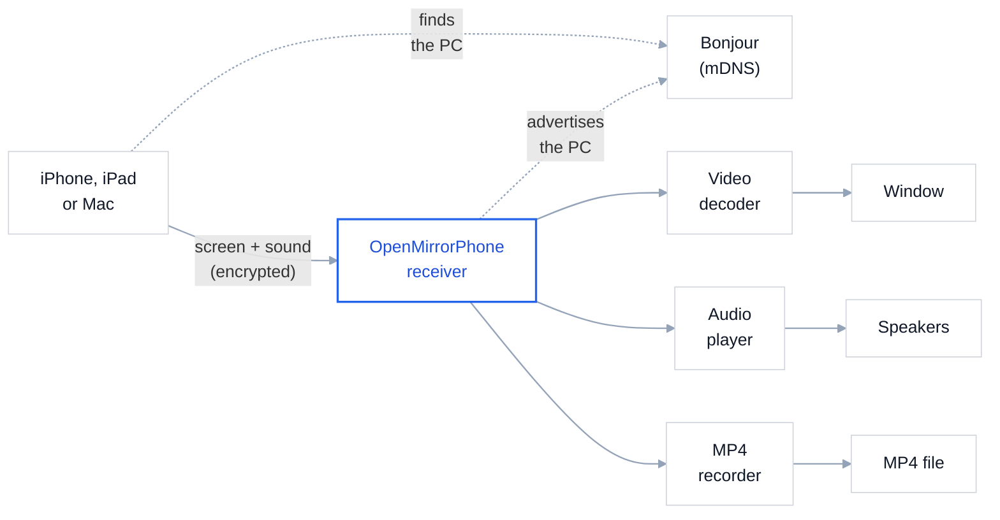
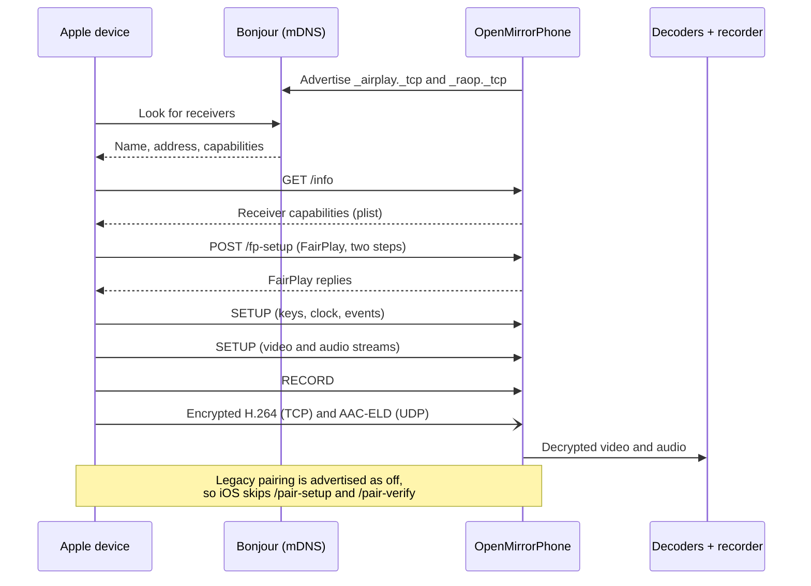
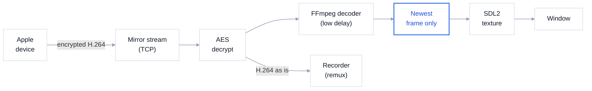
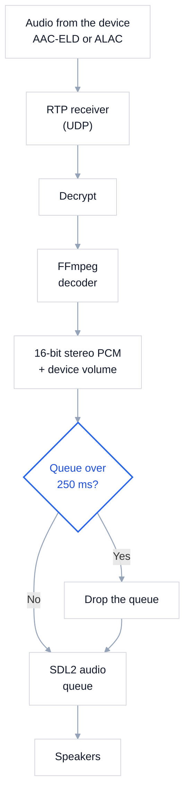
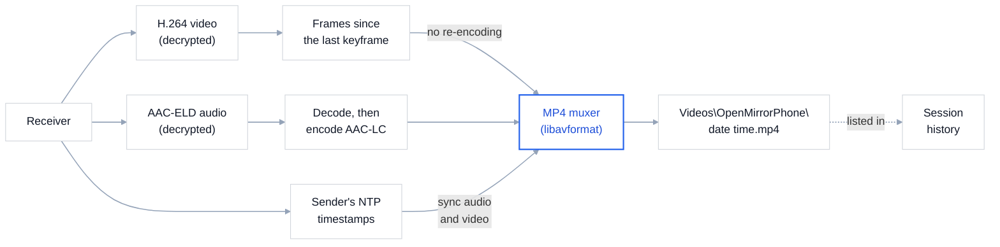
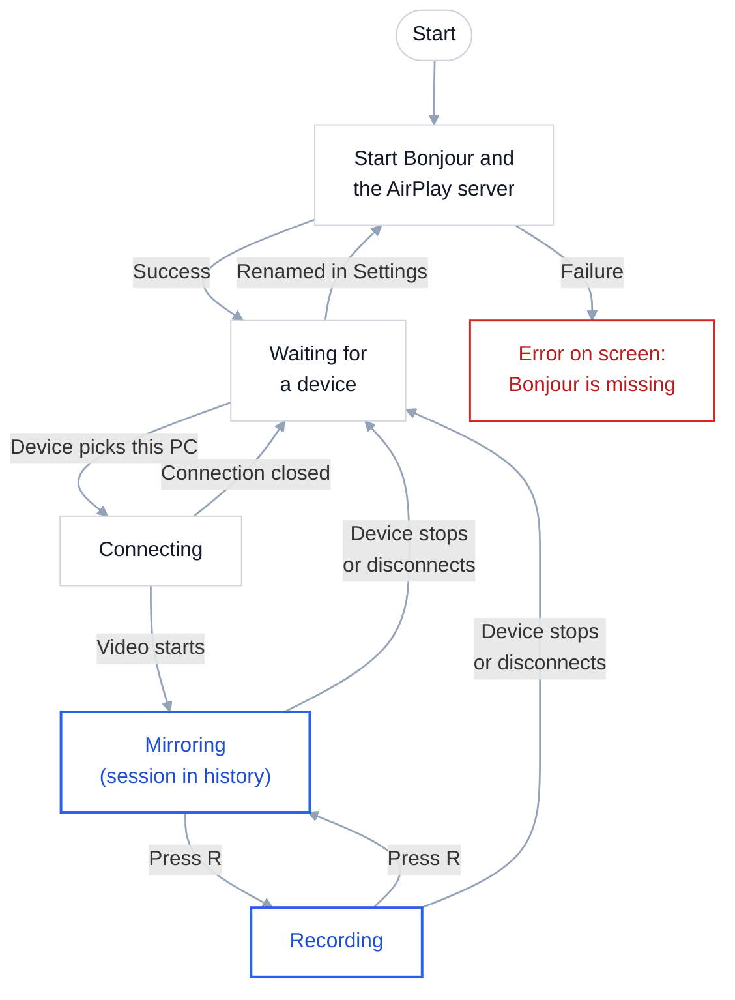
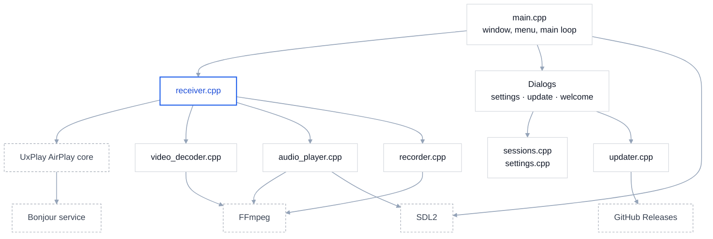

  <picture>
    <source media="(prefers-color-scheme: dark)" srcset="assets/github/logo-wordmark-dark.svg">
    
  </picture>

  Mirror your iPhone, iPad or Mac screen to your Windows PC. Free and open source.

OpenMirrorPhone is an AirPlay-compatible receiver for Windows. Your PC shows up in the
iPhone's Screen Mirroring list as if it were an Apple TV: the phone's screen appears in a
window, with sound, and you can record it to MP4. Nothing needs to be installed on the phone.

> AirPlay, iPhone, iPad and Mac are trademarks of Apple Inc. OpenMirrorPhone is an
> independent project, not affiliated with Apple.

## Features

- Screen mirroring from iPhone, iPad and Mac, with audio
- Low latency: video is shown as soon as it arrives, with no buffering
- Freely resizable window that keeps the screen's aspect ratio
- Full screen with a double-click or F11
- MP4 recording with the **R** key, with no loss of video quality
- Audio from music apps (ALAC) and from mirroring (AAC-ELD)
- A new device can take over from the one that is connected
- Custom receiver name: the one shown in Screen Mirroring
- Session history: every mirroring session with its date, device, duration and recordings,
  which you can rename or delete
- Automatic updates from GitHub, with a "What's New" window after each update
- Completely free: no paid features, no ads, no time limits

## Support the project

OpenMirrorPhone is free and always will be. If it's useful to you and you'd like to support
its development, you can donate with PayPal: **[paypal.me/CallMeElio](https://paypal.me/CallMeElio)**.
The same link is in the app under **Help → Support OpenMirrorPhone…**. Thank you!

## Download

1. Download **`OpenMirrorPhone-x.y.z-setup.exe`** from the
   [latest release](https://github.com/ImElio/openmirrorphone/releases/latest).
2. Run it. It installs for your user only, so no administrator rights are needed, and adds
   OpenMirrorPhone to the Start menu.
3. Start OpenMirrorPhone from the last page of the setup or from the Start menu.

The app is not digitally signed, so the first time Windows may show "Windows protected your
PC": click **More info → Run anyway**.

To uninstall it, use **Settings → Apps → Installed apps** in Windows. Your settings, session
history and recordings are kept.

Prefer a portable copy? Download `OpenMirrorPhone-x.y.z-win64.zip` instead and unzip it into a
folder of your own; the app updates itself inside that folder.

## Requirements

- Windows 10 or 11, 64-bit
- PC and iPhone on the **same network**, Wi-Fi or LAN
- Apple's **Bonjour** service. It is already installed if you have iTunes or the Apple
  Devices app; otherwise install
  [Bonjour Print Services](https://support.apple.com/kb/DL999).

## Usage

1. Start `OpenMirrorPhone.exe`. The first time, a welcome window explains the basics.
2. On first launch Windows asks for firewall access: allow **private networks**.
3. On the iPhone, open Control Center → **Screen Mirroring** → choose your PC's name.

| Key | Action |
|---|---|
| Double-click, F11 | Full screen on/off |
| Esc | Leave full screen |
| R | Start or stop recording |
| Ctrl+, | Open Settings |

Recordings are saved to `Videos\OpenMirrorPhone\<date time>.mp4`. While recording, a "REC"
badge with the elapsed time is shown in the top-left corner. Recording stops on its own when
the phone stops mirroring.

### Settings

Open **Settings → Settings…** in the menu bar (or press Ctrl+,).

- **Receiver name**: the name your iPhone shows in Screen Mirroring. It starts as the PC's
  name. Type a new one and press **Apply**: it is saved and shows up on the phone within a
  few seconds. A device that is mirroring at that moment is disconnected. Maximum length:
  50 bytes (about 50 characters without accents).
- **Session history**: one line per mirroring session.
  - **Rename** (or F2): gives the session a name, for example "Monday lesson". Its
    recordings are renamed to match, e.g. `Monday lesson.mp4`.
  - **Play recording** (or double-click): opens the recording in your video player.
  - **Delete** (or Del): removes the session from the history. If it has a recording, you
    can choose to keep the file or move it to the Recycle Bin.
  - **Open recordings folder**: opens `Videos\OpenMirrorPhone` in Explorer.

- **Updates**: whether to check GitHub for a new version when the app starts (on by default).

The **Settings** menu also has Full screen, Start/stop recording and Open recordings folder.

### Updates

When a new version is published, OpenMirrorPhone shows **Update available** at startup with
what changed. **Install and restart** downloads it, replaces the app's files and starts the
new version; **Later** asks again next time; **Skip this version** stops asking until an even
newer one comes out. The first time the new version opens, **What's New** lists the changes.
You can also use **Help → Check for updates…** at any time, and **Help → What's New** shows the
notes of every version.

Updates are installed in the folder the app runs from. The setup puts it in your user folder,
where that always works; if you use the portable zip, keep it in a folder you can write to
(not in `C:\Program Files`).

### Command-line options

| Option | Meaning |
|---|---|
| `-n NAME` | Name shown on the iPhone for this run only; the name saved in Settings is unchanged |
| `-fs` | Start in full screen |
| `-d` | Verbose protocol log (useful when reporting a problem) |

## How it works

OpenMirrorPhone announces your PC on the local network through Bonjour, the same way an
Apple TV does, so it appears in the iPhone's Screen Mirroring list. When you pick it, the
phone sends its screen and sound straight to the PC, encrypted. OpenMirrorPhone decrypts
them, shows the picture in its window, plays the sound and, if you press R, saves both to an
MP4 file.

Everything stays on your local network. Open the sections below for the details of each step.

<b>Connecting: how the iPhone finds the PC and starts mirroring</b>

The receiver advertises two Bonjour services: `_airplay._tcp` for screen mirroring and
`_raop._tcp` for audio. When the user picks the PC, the device asks for the receiver's
capabilities (`/info`), runs the FairPlay handshake (`/fp-setup`, in
`fairplay_playfair.c`) that yields the stream keys, then opens the streams with RTSP
`SETUP` and `RECORD`. Legacy pairing is advertised as off (feature bit 27), so iOS skips
`/pair-setup` and `/pair-verify` and connects with no PIN.

<b>Video: from the encrypted stream to the window</b>

The mirror stream arrives over TCP as AES-encrypted H.264. `raop_rtp_mirror.c` decrypts it
and hands it to `Receiver`, which passes it both to the decoder and, when recording, to the
recorder as is. The decoder keeps only the newest frame: the window always shows the latest
picture instead of catching up on old ones.

<b>Audio: from the device to the speakers</b>

Audio arrives as RTP over UDP: AAC-ELD while mirroring, ALAC from music apps. After
decryption, FFmpeg decodes it, it is converted to 16-bit stereo PCM with the volume set on the
device applied, and queued on an SDL audio device. If the queue grows past 250 ms it is
dropped, so the delay never builds up.

<b>Recording: how the MP4 file is made</b>

A file can only start on a keyframe, so the recorder always keeps the frames since the last
one: pressing R starts the file at once from that frame. Video is copied into the MP4 without
re-encoding; the AAC-ELD audio is decoded and re-encoded as AAC-LC, which every player
supports. Both tracks are timed with the sender's NTP timestamps, so they stay in sync.

<b>Session lifecycle: what the app does from start to exit</b>

Closing the window ends the app from any state. Renaming the receiver while a device is
mirroring first ends that session, then restarts the receiver under the new name.

<b>Components: how the code is organised</b>

The file-by-file layout and the design choices are in [CONTRIBUTING.md](CONTRIBUTING.md#how-the-code-is-organised).

## Known limitations

- One device at a time; a new device takes over from the previous one.
- No video-by-URL (HLS), no album art or track titles.
- No PIN or password: anyone on the same network can connect.
- Updates are trusted because they come over HTTPS from the project's GitHub releases; the
  zip is not signed or checksummed. Whoever can publish releases can ship code to every user.
- The package is about 140 MB, because MSYS2's FFmpeg build includes every codec. An FFmpeg
  build with only H.264, H.265, AAC and ALAC would bring it down to a few MB.

## Troubleshooting

**The PC doesn't appear in the Screen Mirroring list.**
Check that the PC and the phone are on the same network, that the Bonjour service is running
(`services.msc` → "Bonjour Service") and that the firewall allows OpenMirrorPhone on private
networks. Public and guest Wi-Fi networks often isolate devices from each other.

**The window says "Cannot start: the Apple Bonjour service is required".**
Bonjour is missing: install it (see Requirements) and restart the app.

**Choppy video.**
Mirroring needs a lot of bandwidth: move closer to the router or connect the PC by cable.

## Contributing and security

Bug reports, ideas and pull requests are welcome: see [CONTRIBUTING.md](CONTRIBUTING.md), which
also explains how to build the app. To report a security problem privately, see
[SECURITY.md](SECURITY.md).

## Credits

The AirPlay protocol is implemented by the open-source core of
[UxPlay](https://github.com/FDH2/UxPlay), itself based on RPiPlay and shairplay.
Decoding and recording use [FFmpeg](https://ffmpeg.org/); the window uses
[SDL2](https://www.libsdl.org/).

## License

[GPLv3](LICENSE). UxPlay's AirPlay core is GPLv3, so OpenMirrorPhone is too.
